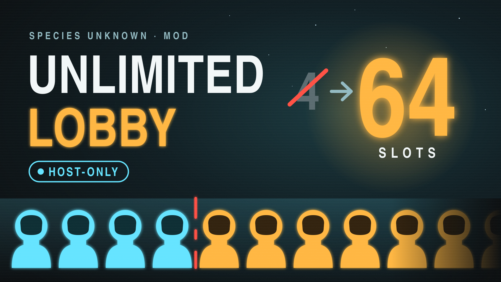

# Unlimited Lobby Size

Lets a host run a Species Unknown lobby with more than the stock four players: as many as an EOS lobby allows
(64 members, minus the game's spectator slots). Only the host installs it.

- **Type:** UE4SS Lua mod (see [docs/ue4ss.md](../../docs/ue4ss.md))
- **Payload:** [`UnlimitedLobbySize/`](UnlimitedLobbySize/), copied or linked into `Win64/ue4ss/Mods/`
- **Status:** complete against the 2026-11-06 build, awaiting its first playtest (see [Test plan](#test-plan))

## Install

1. Install UE4SS for the game ([docs/ue4ss.md](../../docs/ue4ss.md#installing-ue4ss)).
2. Copy `UnlimitedLobbySize/` into
   `Species Unknown/SpeciesUnknown/Binaries/Win64/ue4ss/Mods/`. Developers can run
   `scripts/link-mod.sh unlimited-lobby-size` to symlink it instead.
3. Host a game. The `enabled.txt` inside the folder turns the mod on without editing `mods.txt`.

To set a lower cap, lower `MAX_LOBBY_MEMBERS` at the top of `Scripts/main.lua`.

## How the game caps players

Read from the game's Blueprint bytecode (see [docs/reverse-engineering.md](../../docs/reverse-engineering.md)).
Everything below runs on the host.

**One variable drives the cap.** `BP_MyGameInstance.playerLobbyCapacity` (int64, class default, never assigned
by the Blueprints) feeds:

- the player EOS lobby: `Make Player Lobby Transaction` calls `SetCapacity(playerLobbyCapacity)`;
- the voice chat EOS lobby: `SetCapacity(playerLobbyCapacity + spectatorLobbyCapacity)`;
- the main session: `MakeMainSessionSettings(playerLobbyCapacity)` sets `NumPublicConnections`;
- player-id slots: `CheckAllowConnectionLobby`, `PlayerIdFromUNetId` and `RegisterPlayerFunc` loop over slots
  `0 .. playerLobbyCapacity - 1`;
- the auto-kick: `BP_MyGameState.CheckAutoKickMaxPlayersNumber` kicks a joining player when `PlayerArray` is longer
  than `playerLobbyCapacity`.

**Two session builders hard-code their slots** instead: `MakePrivateSessionSettings` (join-by-code sessions) uses
10 public connections, and `MakePublicSessionSettings` uses 4 public + 4 private.

**The "more than 4 players" check doesn't kick.** `BP_LobbyGameMode.Check More Than 4Players` counts players in
the scene, and when there are more than four it sets `had_more_than_4_players`, prints a debug message (only with
the game's online debug tag on) and calls `TryFixModeThan4Players`, which is empty. It also reports an
`ASSERT_FAILED_MORE_THAN_4_PLAYER_IN_LOBBY` event through the game's analytics subsystem, so **the developers'
telemetry will see lobbies with more than four players.**

## Shuttle seats

`BP_PlayerShip` spawns exactly four `BP_Seat` actors (`SpawnSingleChair` for `SceneChair1` to `SceneChair4`), and
every launch waits for seated players:

- **Starting a mission** (`CheckForLaunch`, lobby state): launches only when the number seated equals the number of
  in-game players, then `LaunchLobby` travels everyone to the mission.
- **Escaping at mission end** (`CheckForLaunch`, emergency state): launches only when every player inside the ship is
  seated, the doors are closed and no monster is inside. `LaunchEscape` receives the seated players; the escape
  sequence treats only those as escaped.
- **Seats unlock** (`Check Can Sit`) only once every in-game player is inside the shuttle.
- **End-of-mission score** (`Check Player Sit End`) waits for the number seated to reach the number of in-game players.

With five or more players none of these can be met, so the mod adds **standing room**: once all four seats are
taken, players standing inside the shuttle count as seated. Everything else the game checks still applies: everyone
must be aboard to start a mission, and the doors must be closed with no monster inside to escape.

- **Starting a mission** travels every player to the mission map, seated or standing.
- **Escaping** launches with everyone aboard. `LaunchEscape` still gets only the four seated players, and the
  game reads that list for one thing: during the escape cinematic, a seated player's HUD hides and their music
  fades. Standing players keep their HUD up for the cinematic. Nothing in scoring or survival reads the list.

## How the mod works

The mod pre-hooks `/Script/Engine.BlueprintAsyncActionBase:Activate`, which every async Blueprint node runs
through. The game starts one (`AutoLogin`) at launch, long before anyone can host.

1. **On the first async node**, it raises `playerLobbyCapacity` to `MAX_LOBBY_MEMBERS - spectatorLobbyCapacity`,
   so the chat lobby (players + spectators) stays within the 64-member EOS limit. From then on, the game builds
   every lobby, session, slot loop and kick check from the new number by itself. It also sets the engine's
   `net.MaxPlayersOverride` to the same number, because `AGameSession::AtCapacity` checks logins against the
   engine's own cap and a console variable survives map travel.
2. **On every create or update session node**, it raises the session's slots to the player capacity. That covers
   the two builders that hard-code 10 and 4 + 4. OSB copies a node's inputs into `__Store__NewSessionSettings` /
   `__Store__UpdatedSessionSettings`, and the hook edits them before the native `Activate()` reads them.
3. **Standing room.** When a shuttle class loads, the mod post-hooks its `CheckForLaunch` and
   `Check Player Sit End`, which the ship re-runs on server timers. When the game's check has just failed with every
   seat taken and more players inside, the mod raises `NbPlayerSited` to the number inside, runs the game's own
   check again, and restores the real count. `NbPlayerSited` is read only by those checks and isn't replicated, so
   nothing else sees the temporary value.

The hook reads object properties, never the hooked call's parameters, so it doesn't depend on how UE4SS passes
the arguments of a native function called from Blueprint.

## Who installs it

The host. Everything that enforces the cap runs on the host.

A client that also installs it raises its own copy of `playerLobbyCapacity`. That does nothing to the cap, but the
player-id slot loops also run on clients (for example while registering players), so unmodded clients may not
resolve the ids of players five and up. If a playtest shows missing names, voice or colours for those players on
unmodded clients, have everyone install the mod.

## Test plan

UE4SS writes everything the mod prints to `Win64/ue4ss/UE4SS.log`.

1. Launch with UE4SS and the mod installed. The log shows
   `[UnlimitedLobbySize] playerLobbyCapacity 4 -> N (64 EOS slots minus S spectator slots)` shortly after the
   main menu loads. Note `N`: it is the real cap.
   - `No BP_MyGameInstance_C yet` repeating without the capacity line means a game patch renamed the class.
   - No line at all means the hook never fired; report it.
2. Host a lobby by code. The log shows
   `[UnlimitedLobbySize] OnlineSessionSubsystemCreateSession: public 10 -> N, private 0 -> 0`.
3. Open the UE4SS console (`F10` or `@`) and run `net.MaxPlayersOverride`. It reports `N`.
4. Have five or more players join, with the host as the only one running the mod. Note anything that breaks:
   failed joins, kicks, missing names, colours or voice for players five and up, spawn problems, a scoreboard
   that cuts off.
5. With five or more players, fill all four seats with the others standing inside the shuttle. The shuttle
   launches to the mission (the log shows `Shuttle class loaded` once per map). Then try with one player still
   outside: it must not launch.
6. At the end of the mission, board with four seated and the rest standing, doors closed. The escape launches,
   everyone reaches the score screen, and the standing players arrive back in the lobby with their rewards.
   Note anything odd for the standing players during the escape cinematic.
7. After travelling back to the lobby, check that everyone stays connected and a new player can still join.
8. Repeat steps 4 to 6 with every player running the mod, if they showed client-side glitches.
